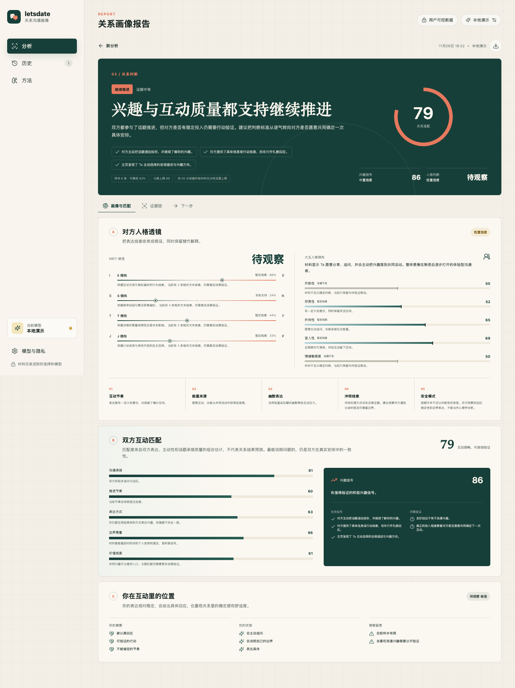

# letsdate

**把关系里的模糊感，拆成能验证的信号。**

letsdate 是一个面向 18-30 岁青年男女的关系沟通画像工具。它从用户提供的双方主页和聊天记录中提取可解释证据，输出人格倾向、互动匹配、兴趣信号、关系判断和下一步沟通建议。

项目不是“读心术”，也不会把 MBTI 或大五人格包装成确定结论。每条判断都要求绑定原话、说明可能解释，并标注置信度。

[在线体验](https://luxios06.github.io/letsdate/) · [Agent Skill](./public/skills/letsdate-relationship-analysis/SKILL.md) · [产品说明](./docs/PRODUCT.md) · [人格说明](./docs/PERSONALITY.md) · [本地模型](./docs/LOCAL_MODEL.md) · [导入说明](./docs/IMPORT.md) · [演示剧本](./docs/DEMO_SCRIPT.md) · [WechatVibe 评估](./docs/WECHATVIBE_REVIEW.md)



## 为什么做

Dating App 和小红书等平台让人更容易认识新的人，也让“对方到底怎么想”变成高频焦虑。现有工具通常只做聊天情绪、回复建议、问卷测评或单纯的 MBTI 分类，很少同时处理：

- 主页中的自我呈现与价值线索。
- 聊天中的双向主动性、回应质量和边界。
- 人格假设、当前兴趣与关系适配之间的区别。
- 判断所依赖的证据、不确定性和反证。

letsdate 把这些能力收束成一个可解释的闭环：

`输入材料 → 提取证据 → 形成人格与互动假设 → 分析兴趣和匹配 → 给出可撤回的下一步`

## 核心能力

- **跨模型 Agent Skill**：分析协议不依赖单一模型，可接入 OpenAI、DeepSeek、Anthropic、Gemini、Ollama 和 OpenAI 兼容接口。
- **双人视角**：分别分析用户与对方，同时评估双方互动，不把所有结果归因给一个人。
- **决断型人格倾向**：基于 KnowMe 行为信号与 OpenJung 维度清晰度思路，给出最可能的 MBTI 类型、替代类型、判断依据和可直接使用的沟通建议，不再默认停在“待观察”。
- **证据链**：事实观察、可能推断、反证和置信度分开呈现。
- **逐消息情绪与意图**：每条发言给出一组情绪、沟通意图和关系线索，控制与边界风险优先标记。
- **可选本地模型增强**：默认本地规则不打额外请求；切换 Ollama 后由本机模型增强逐消息标签。
- **关系动作**：给出继续推进、适度推进、先观察或暂缓推进的判断，并提供自然、可撤回的消息草稿。
- **校准分数**：按对方消息量、双向回合和证据可靠性收缩，文本证据不会直接给出 100 分。
- **三种回复语气**：留空间、直接确认和轻松一点，并优先复用聊天中已经出现的日期与活动。
- **短回复语境分析**：对“嗯、哦、好”等消息比较个人基线、回复间隔和后续恢复，不直接判断冷淡。
- **依恋互动线索**：安全、焦虑和回避只作为分维度互动线索，缺证据时明确显示不足。
- **两阶段模型分析**：先提取并逐字核验事实，再综合人格、关系和行动建议。
- **人话优先报告**：先说明能确认什么、可能是什么、还有什么解释以及下一步观察。
- **情感与亲密信号**：本地 DUTIR 七类情绪词典结合亲密关系规则，短对话也会给出建议和补充信息。
- **匿名案例检索增强**：从公开授权数据派生并脱敏的情境案例中检索相似模式，只扩展解释和行动建议，不作为对方证据。
- **批量截图 OCR**：一次选择最多 12 张中文聊天或主页截图，顺序识别、逐张显示进度，并去除相邻截图边界重复消息；PaddleOCR PP-OCRv6 主识别，Tesseract 兜底。
- **隐私可控**：历史记录默认只存在本地；API Key 默认只在当前标签页会话中保存；支持一键清除。
- **PWA 基础**：可安装到桌面或手机主屏幕，为后续原生 App 上架预留基础。

## 技术结构

```text
.
├── public/
│   ├── skills/letsdate-relationship-analysis/
│   │                              # 跨模型 Agent Skill 与证据评分规则
│   ├── knowledge/cases.json       # 匿名派生与虚构关系情境案例
│   ├── emotion/cnsenti-lexicon.json
│   ├── brand-mark.svg
│   ├── manifest.webmanifest
│   └── sw.js
├── src/
│   ├── components/               # 工作台、报告、历史、设置与方法页
│   ├── lib/
│   │   ├── analyzer.ts           # 无 API 也能运行的本地演示引擎
│   │   ├── conversation.ts       # 时间戳、会话、短回复、计划和依恋线索
│   │   ├── calibration.ts        # 分数收缩、MBTI 状态和上下文回复
│   │   ├── providers.ts          # OpenAI / DeepSeek / Anthropic / Gemini / Ollama
│   │   ├── report-schema.ts      # zod 报告结构校验
│   │   ├── ocr.ts                # OCR 调度、清洗与 Tesseract 兜底
│   │   ├── ocr-paddle.ts         # PaddleOCR PP-OCRv6 与聊天气泡恢复
│   │   ├── emotion-analysis.ts   # 中文情绪与亲密关系信号
│   │   ├── knowledge.ts          # 情境案例检索与安全降权
│   │   └── storage.ts            # 本地历史与密钥策略
│   ├── App.tsx
│   └── styles.css
├── data-pipeline/                # 可复现的匿名化、聚类与案例构建管线
├── local-model/                  # ModelScope Qwen3 + Ollama 一键本机模型
├── docs/
└── .github/workflows/deploy-pages.yml
```

## 本地运行

要求 Node.js 22+ 和 pnpm 11+。

```bash
pnpm install
pnpm dev
```

打开 `http://localhost:4173/`。

生产构建：

```bash
pnpm test
pnpm build
pnpm preview
```

## 模型配置

1. 点击页面右上角或侧边栏的“模型与隐私”。
2. 选择供应商。
3. 填写 Base URL、模型 ID 和 API Key。
4. 不配置 API 时，可直接使用“本地演示”跑通完整报告。

API Key 默认只写入 `sessionStorage`，关闭当前标签页后清除。只有主动勾选“在本机浏览器记住 API Key”时才写入 `localStorage`。

浏览器直连第三方 API 可能受到 CORS 限制。遇到连接错误时，可切换为本地演示，或使用支持浏览器跨域的接口代理。

## Agent Skill

入口文件：[`public/skills/letsdate-relationship-analysis/SKILL.md`](./public/skills/letsdate-relationship-analysis/SKILL.md)

Skill 包含：

- 精确引文、证据 ID 与来源状态。
- MBTI、大五人格和互动模式的分析规则。
- 分数收缩、材料上限与决策阈值。
- 三种语气的可执行回复建议。
- 置信度、反证与安全边界。
- 完整 JSON 输出协议。

任意支持系统提示词和结构化输出的 Agent 都可以读取 `SKILL.md` 以及 `references/` 下的证据、校准、情感和案例检索规则来复用分析协议。

## 数据与伦理

- 项目分析的是用户提供的材料，不自动登录或抓取小红书、Dating App 或其他平台账号。
- 用户应确认已获得必要授权，并在上传前删除姓名、电话、地址、账号等可识别信息。
- 选择云端模型时，材料会发送到对应模型供应商，并适用该供应商的数据政策。
- 案例库只包含公开授权数据的匿名派生摘要和完全虚构案例，不公开原始敏感对话，也不会用案例相似度证明当前对象的想法。
- MBTI 与大五人格输出是沟通假设，不是心理诊断。
- 禁止将结果用于操控、跟踪、施压、欺骗或绕过对方边界。

详见 [隐私说明](./docs/PRIVACY.md)。

## 已验证

- `pnpm test`：47 个分析、人格倾向、消息标签、会话、短回复、情感、案例检索、批量 OCR、两阶段模型与边界测试通过。
- `pnpm check`：TypeScript 类型检查通过。
- `pnpm build`：生产构建通过。
- Playwright：桌面与 390px 手机视口完成输入、示例分析、报告页、证据页和行动页交互验证。
- 关键视口无横向溢出，浏览器控制台无错误。
- Skill 结构通过 `quick_validate.py` 校验。
- 五日长对话、跨场景证据抽样和最终计划确认测试通过。

## Roadmap

- 平台账号授权导入与更细粒度的数据权限。
- 服务端加密存储、跨设备同步与团队版。
- 多模态分析：头像、语音、图片和视频内容。
- 关系时间线与多时间点变化对比。
- 原生 iOS / Android 应用与心理健康安全审核。
- 经过同意的人格结果校准与可解释性评估。

## License

[MIT](./LICENSE)
