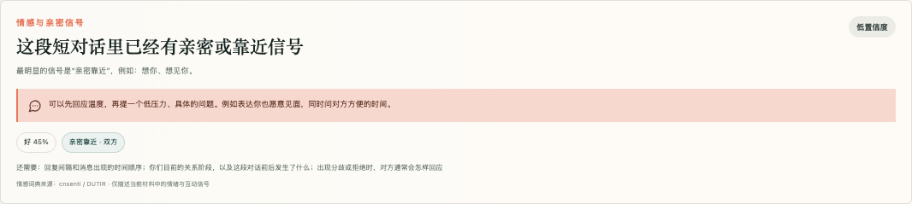
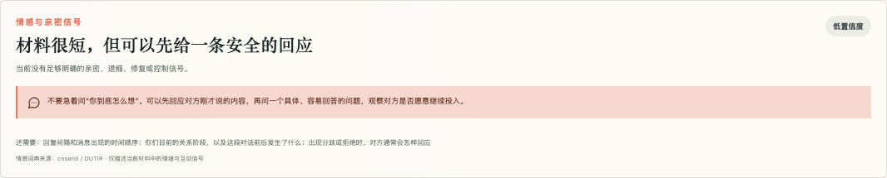

# Emotion and Intimacy Analysis

letsdate uses a local emotion layer before model synthesis.

## Sources

- cnsenti DUTIR seven-emotion dictionary: good, joy, sadness, anger, fear, disgust, surprise.
- cnsenti HowNet negation and intensity modifiers.
- letsdate relationship-specific rules for closeness, flirtation, reassurance seeking, withdrawal, control, repair, boundaries and future commitment.

The raw dictionary is converted to `public/emotion/cnsenti-lexicon.json` at build time from the MIT-licensed cnsenti repository.

## Processing

1. Segment Chinese text with `Intl.Segmenter`.
2. Match emotion words and apply negation/intensity modifiers.
3. Compute valence and emotion intensity.
4. Detect relationship-specific signals.
5. Produce a short, user-facing reading and always include one low-pressure suggestion.
6. Add targeted missing-information questions.

## Short conversations

The system always returns:

- one observation visible in the material;
- one actionable suggestion;
- one alternative explanation;
- at least one question that could improve the judgment.

It never stops at only "insufficient evidence" or "wait and see".

## Safety overrides

Control signals such as phone checking, location demands, isolation or forced reporting take priority over romantic interpretation. They are treated as boundary and safety risks.

When a control signal is present, the final decision is forced to `暂缓推进`, compatibility is capped at 32 and interest at 28, even if the surrounding conversation contains warmth.

Repair is checked before generic boundary wording when an apology is followed by a concrete future adjustment. This prevents a conflict sentence such as "you did not tell me in advance" from hiding the later repair behavior.

## Limitations

- A word can belong to multiple emotion families.
- Irony, quotation and reported speech require semantic review.
- Lexicon scores are not clinical measurements.
- Short text still has low confidence, but it can support a safe next action and targeted follow-up questions.

## Visual verification

Five-message intimacy example:

Four-message ambiguous example:

