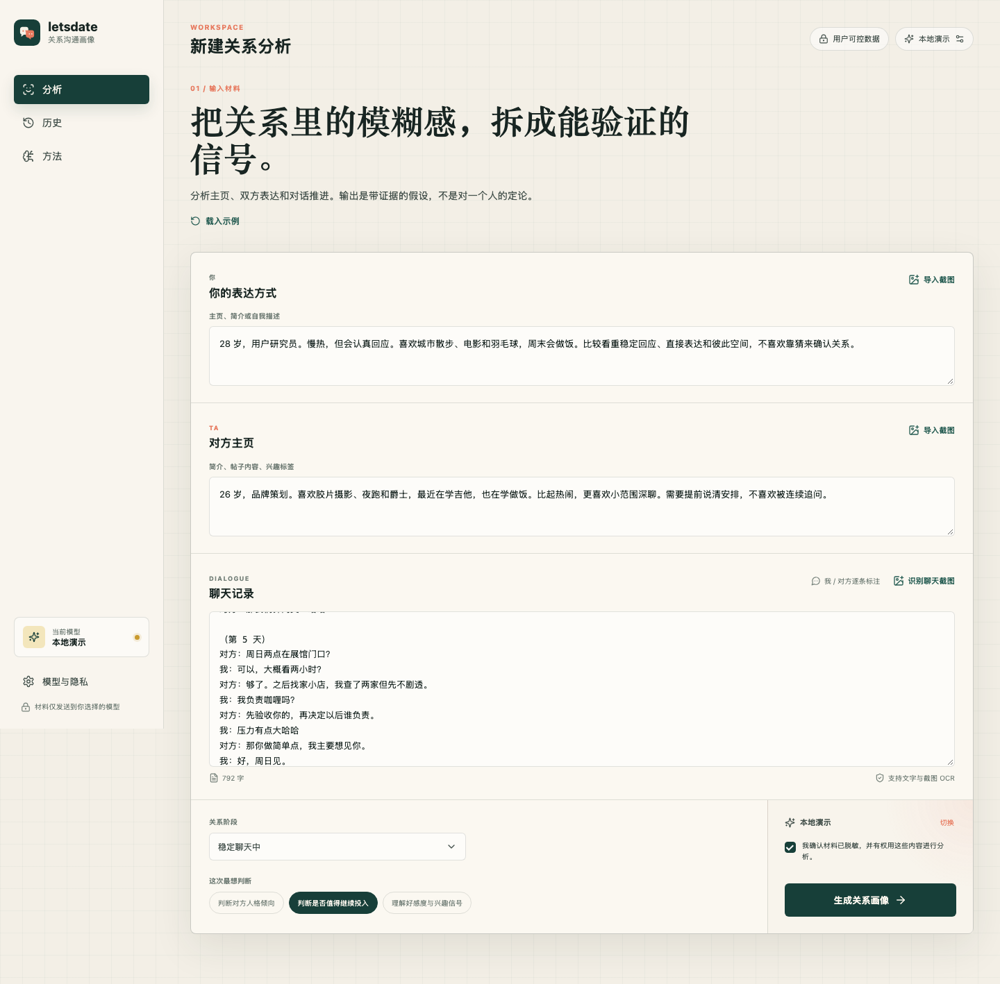
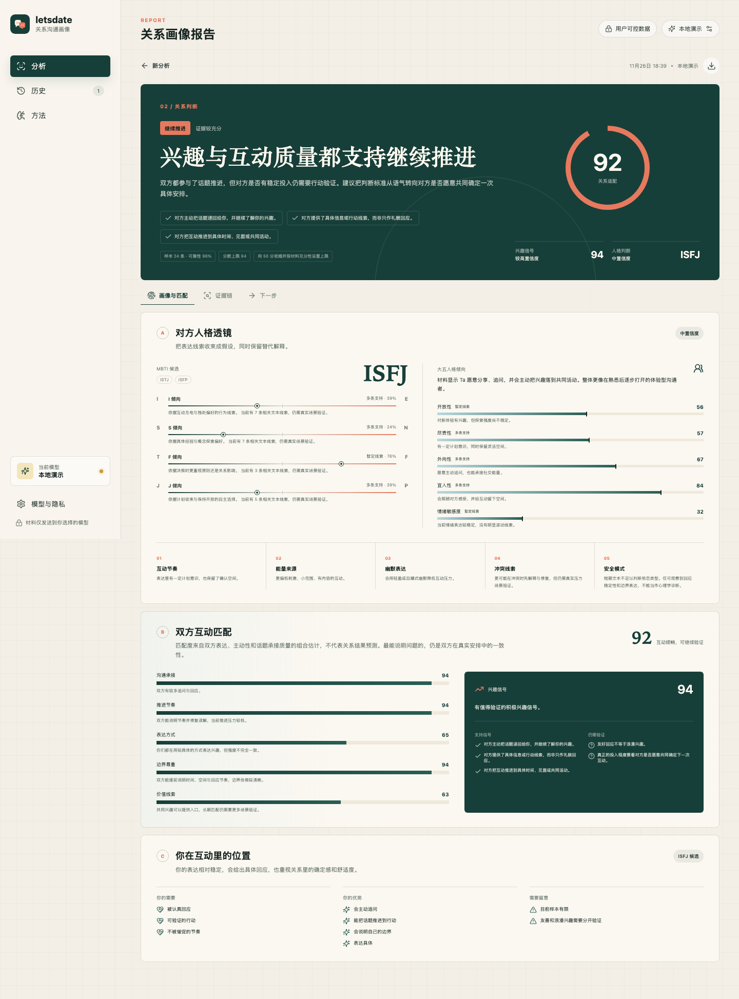
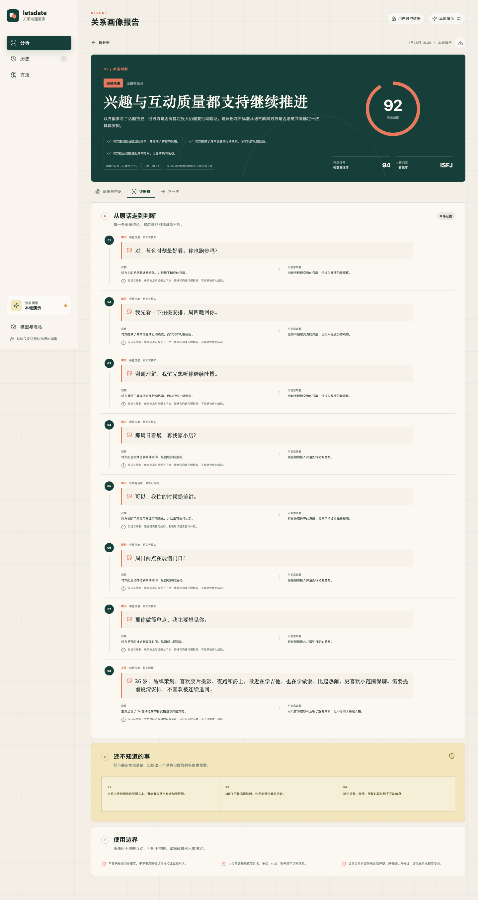
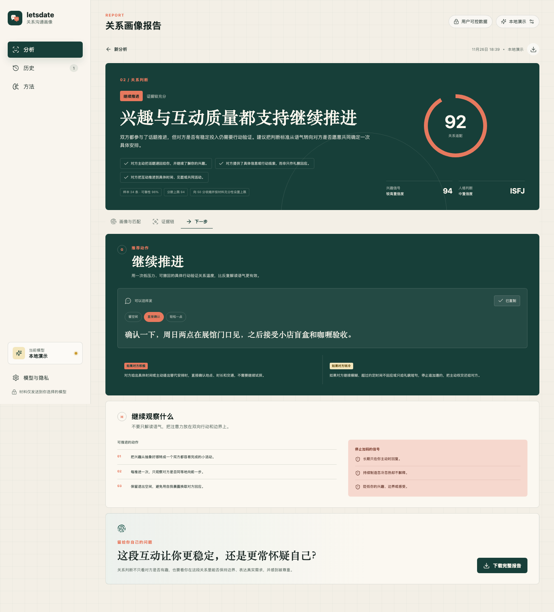

# Long Dialogue Simulation

Date: 2026-11-26

## Scenario

Two fictional adults with public profiles and a five-day conversation.

Coverage:

- First match and profile-based opener.
- Daily small talk and hobbies.
- Flirtation and light teasing.
- Work stress and emotional support.
- Making, rejecting and replacing a plan.
- A small disappointment caused by unclear scheduling.
- Apology, clarification and repair.
- Boundary negotiation around reply speed and quiet time.
- Explicit interest and final date confirmation.

Scale:

- 24 messages from the other person.
- Roughly 38 alternating dialogue turns.
- Multiple days and contexts.

## Initial Findings

The first run exposed three real long-context defects:

1. Evidence only sampled the first four messages.
2. The latest confirmed plan was ignored, so the reply still asked for confirmation.
3. Words such as "busy" and "no rush" were over-counted as cold signals.

## Fixes

- Evidence now samples across the whole conversation using seven distributed positions.
- Conflict, repair, boundary and commitment signals receive different explanations and cautions.
- The latest eight turns determine whether a plan is already confirmed.
- The latest explicit day, time and venue replace older proposals.
- Cold-signal detection now requires clear withdrawal or rejection language.
- Repair and boundary signals contribute to pace and boundary-fit dimensions.

## Final Result

- Calibrated compatibility: 92.
- Interest: 94.
- Reliability: 96%.
- Score cap: 94.
- MBTI candidate: ISFJ, medium confidence.
- Evidence items: 8, covering opening, scheduling, support, repair, boundaries and final agreement.
- Final reply correctly uses "Sunday at 2", "exhibition entrance", "small restaurant" and "curry".

## Visual Evidence

