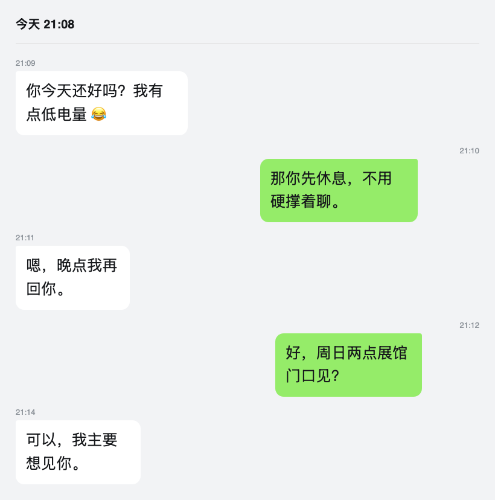
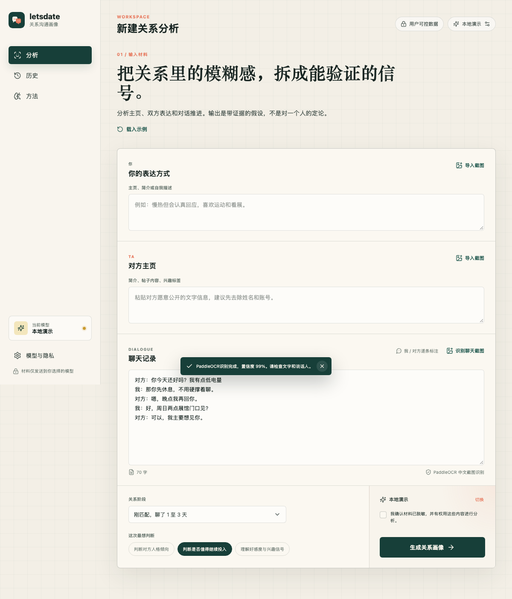

# OCR Pipeline

letsdate uses a browser-native hybrid OCR pipeline.

## Primary engine

- PaddleOCR.js official browser SDK.
- PP-OCRv6 Chinese detection and recognition models.
- ONNX Runtime Web with WASM backend.
- Main-thread inference for compatibility with GitHub Pages.

The first OCR request downloads the official PaddleOCR model archives and can take longer than later requests.

## Image preprocessing

- Screenshots are scaled up when they are small.
- Long screenshots are capped to avoid unnecessary memory use.
- Contrast and brightness are mildly enhanced.
- High-quality canvas smoothing is used before inference.

## Chat structure recovery

For chat screenshots:

1. Detect every text line and its polygon.
2. Remove timestamps and common UI labels.
3. Group vertically adjacent lines on the same side into one bubble.
4. Infer SELF versus OTHER from bubble position.
5. Preserve newlines between bubbles.
6. Normalize spaces only within each line.

This avoids treating every wrapped line as a separate speaker.

## Fallback

If PaddleOCR cannot initialize or returns no usable text:

- The same preprocessed image is sent to Tesseract.js.
- Chinese and English language data are used.
- The UI reports that fallback was used.

## Validation fixtures

### Profile text

Input:

```text
慢热但会认真回应，喜欢看展和跑步。
希望遇到愿意一起探索、尊重彼此空间的人。
```

Output:

```text
慢热但会认真回应，喜欢看展和跑步。
希望遇到愿意一起探索、尊重彼此空间的人。
```

### Chat bubbles

Input contains five left/right chat bubbles with timestamps.

Output:

```text
对方：你今天还好吗？我有点低电量
我：那你先休息，不用硬撑着聊。
对方：嗯，晚点我再回你。
我：好，周日两点展馆门口见？
对方：可以，我主要想见你。
```

No fallback was used for these fixtures.

## Visual verification

Chat screenshot fixture:



Recognized and structured result in letsdate:


