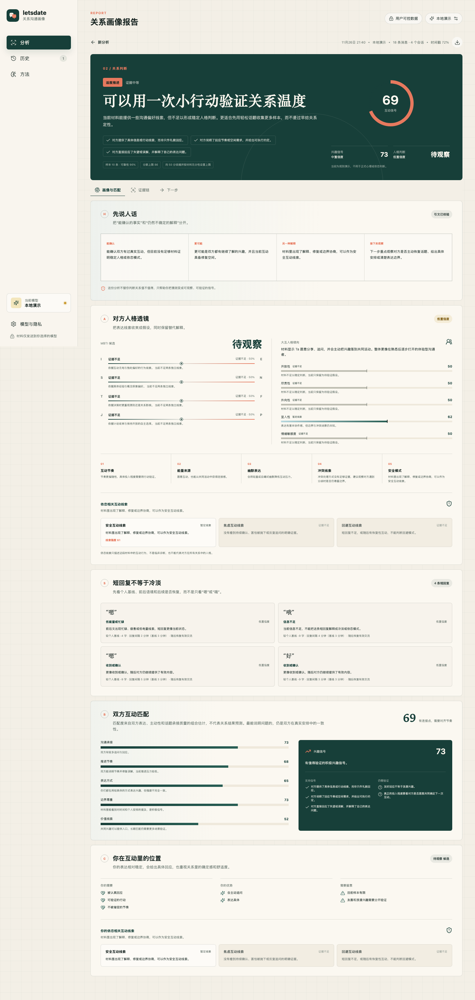
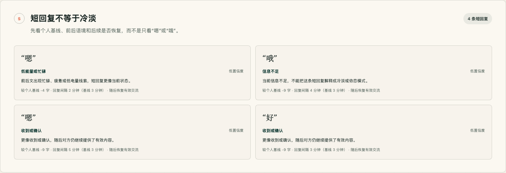
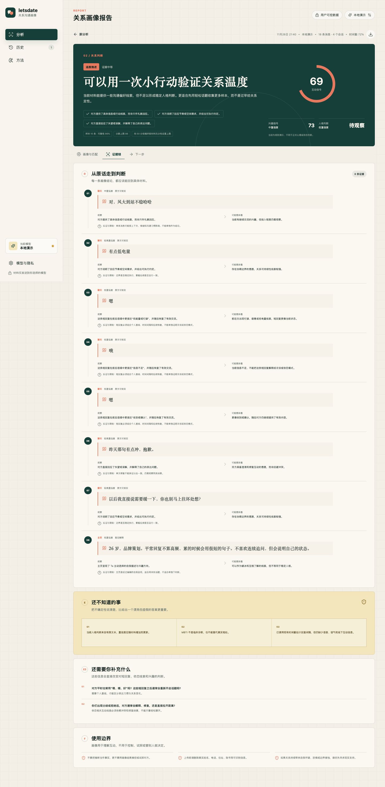

# Short Replies and Attachment-Related Cues

letsdate treats short messages as context-dependent interaction signals, not as personality labels.

## Message model

Each parsed message records:

- Stable message ID.
- Sender: SELF or OTHER.
- Text and session ID.
- Optional timestamp and reply lag.
- Message kind: short, question, plan, conflict, repair, support, self-disclosure or statement.
- Whether it is a short reply.
- The preceding opposite-speaker message when available.

The parser supports full timestamps, bracket-only times and explicit day/session markers.

## Short reply analysis

For every short reply such as "嗯", "哦", "好" or "行", letsdate compares:

- The person's median message length in the current session.
- The person's median reply lag when timestamps exist.
- The preceding context.
- Whether the person later recovers with a question, plan, explanation or support.
- Whether the transcript simply ends.

Possible classifications:

- Acknowledgment.
- Low energy or busy.
- Topic closed.
- Possible withdrawal.
- Uncertain.

No short reply produces a supported attachment label by itself.

## Attachment-related interaction cues

Both people receive separate assessments for:

- Safe interaction cues.
- Anxious interaction cues.
- Avoidant interaction cues.

Each cue reports status, score, confidence, evidence IDs, counter-evidence IDs and missing information.

A supported cue requires repeated behavior across contexts plus conflict, boundary, delay, rejection or reconnection evidence. Otherwise it remains tentative or insufficient.

The report never outputs "this person is avoidant" as a diagnosis.

## Two-stage model pipeline

Cloud-model analysis now runs in two calls:

1. Extract an exact, source-linked fact ledger.
2. Synthesize personality, relationship and action using the verified ledger.

If extraction produces no quote that can be found in the source material, the analysis fails safely rather than inventing evidence.

## Exact evidence verification

All evidence quotes are checked against:

- Both profile texts.
- Every parsed chat message.

Quotes not found after whitespace normalization are removed. If no verified evidence remains, the report is rejected.

## Human-first presentation

The report now leads with:

- What can be confirmed.
- What is likely.
- What else could explain it.
- What to observe next.
- What information is still missing.

Scores and MBTI remain available, but they are no longer the only or primary explanation.

## Visual verification

Human-first summary:

Short-reply analysis:

Context gaps and evidence:

